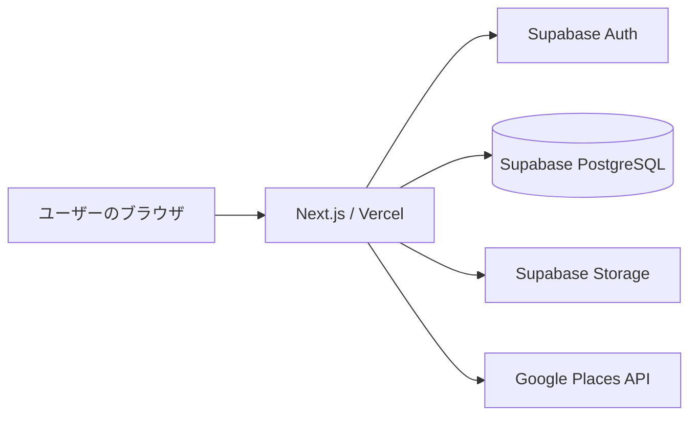

# FoodKit

**「誰がおすすめするか」で、次に行きたいお店が見つかる。**

FoodKitは、飲食店での体験を記録・共有し、**自分と食の好みが近い人やフォローしている人の記録**をもとに、お店を探せるWebアプリです。

評価の高さだけでは分からない「自分に合うお店」を見つけられるよう、レビューとユーザー同士のつながりを組み合わせています。企画は学生チームのメンバー全員で行い、アプリケーションの実装は主に私が担当しました。現在も継続して改善しています。

**[FoodKitを使ってみる](https://food-kit.vercel.app)**  |  [ソースコード](https://github.com/aekg8812/FoodKit)

> **公開状況：** Web版を公開中（継続開発中）。閲覧・記録機能の利用にはアカウント登録が必要です。

## 開発背景

飲食店を探すとき、一般的な評価やレビューだけでは「自分の好みに合うか」を判断しにくいと感じることがあります。一方、友人からのおすすめは、相手の好みを知っているからこそ参考になります。

そこでFoodKitでは、**「どんな評価か」だけでなく「誰の評価か」**に着目しました。食の好みやフォロー関係、実際の訪問記録を活用し、納得感のあるお店選びを支援することを目指しています。

## 開発体制と担当範囲

FoodKitは、学生チームのメンバー全員でアイデアを出し合い、サービスの方向性や必要な機能を検討したプロジェクトです。

私は**アプリケーションの実装の大部分**を担当しました。フロントエンドからSupabaseを利用したデータ管理・認証、推薦機能の実装まで幅広く取り組み、動作検証と本番公開も進めました。

企画をチームで行う一方、実装を主に担当する立場として、機能の優先順位や保守性を意識しながら開発を進めています。

## 主な機能

| 機能 | 概要 |
| --- | --- |
| 飲食店の検索・登録 | 店名・エリアなどで検索。未登録のお店は追加でき、Google Placesを利用した店舗検索にも対応。 |
| 訪問記録・レビュー | 4段階の評価、コメント、訪問日、写真を記録。投稿後の編集にも対応。 |
| 好みの登録 | オンボーディングで食の好みを選択し、ユーザープロフィールに反映。 |
| おすすめ（FoodKit Match） | 好みが近い人やフォロー中の人のレビューを手がかりに、飲食店を提案。 |
| 「今日のお店」検索 | 予算、ジャンル、利用シーンなどの条件から候補を絞り込み。 |
| グループ機能 | 招待コードでグループを作成・参加し、メンバーの好みを踏まえたお店探しを支援。 |
| フォロー・通知 | ユーザーをフォローし、訪問記録や通知を確認。 |

※ おすすめの表示内容や検索条件による絞り込み結果は、登録されているレビュー・店舗情報に依存します。

## 技術スタック

| 分野 | 使用技術 |
| --- | --- |
| フロントエンド / Webアプリ | Next.js 16（App Router）、React 19、TypeScript |
| UI・スタイリング | Tailwind CSS 4 |
| バックエンド / データベース | Supabase（PostgreSQL、Auth、Storage、RLS） |
| 店舗情報 | Google Places API |
| ホスティング | Vercel |
| 開発・品質確認 | ESLint、TypeScript型チェック、ビルド検証、Supabase CLI、QAスクリプト |

## システム構成



- **Next.js App Router**：画面・サーバー処理を実装し、認証状態に応じて画面遷移を制御。
- **Supabase Auth / RLS**：ユーザー認証とデータへのアクセス制御を担当。
- **PostgreSQL**：店舗、レビュー、好み、フォロー、グループなどの情報を管理。
- **Supabase Storage**：レビュー画像や店舗画像を保存。保護対象の画像は非公開バケットを使用。

## 設計・開発で工夫した点

### 1. 評価と「人との相性」を組み合わせた推薦

単純な総合評価順ではなく、**好みの近さとフォロー関係**を推薦の手がかりにしています。また、おすすめの根拠を画面上で伝えることで、ユーザーが判断しやすい設計を目指しました。

### 2. 認証・権限制御を前提としたデータ設計

SupabaseのRow Level Security（RLS）を利用し、プロフィールや各種操作のアクセス権限をデータベース側でも制御しています。ブラウザから管理者用の秘密鍵を扱わない構成としています。

**公開範囲について：** 投稿したレビューと写真は、FoodKitにログインしているユーザーが閲覧できる仕様です。グループ限定公開ではありません。

### 3. スマートフォンでの使いやすさ

幅375pxを基準に画面を設計し、ホーム・検索・記録・グループ・マイページの**5タブ**で主要機能にアクセスできるUIにしています。

### 4. 段階的な実装と動作検証

機能ごとに実装と確認を積み重ね、Lint、TypeScript型チェック、本番ビルドに加えて、ローカルのQAスクリプトやブラウザでの操作確認を行っています。

## ローカルでの起動

### 必要なもの

- Node.js、npm
- Docker（ローカルSupabaseを利用する場合）
- Supabase CLI（本リポジトリの開発依存関係に含まれます）

```bash
# リポジトリを取得
git clone https://github.com/aekg8812/FoodKit.git
cd FoodKit

# 依存関係をインストール
npm ci

# ローカルSupabaseを起動（Dockerが必要）
npx supabase start
```

プロジェクト直下に `.env.local` を作成し、**自分の開発環境の値**を設定してください。

```dotenv
NEXT_PUBLIC_SUPABASE_URL=<Supabase の URL>
NEXT_PUBLIC_SUPABASE_PUBLISHABLE_KEY=<Supabase のクライアント用キー>
```

ローカルSupabaseのURLとキーは `npx supabase status` などで確認できます。Google Places連携や一部のサーバー側機能を利用する場合は、それぞれ対応するAPIキー・サーバー専用環境変数の設定も必要です。**秘密鍵をGitにコミットしないでください。**

```bash
npm run dev
```

[http://localhost:3000](http://localhost:3000) で確認できます。

> **注意：** `npm run qa:reset` はローカルDBを初期化する破壊的な操作です。通常の開発用DBでは実行せず、独立したQA環境でのみ使用してください。詳細は [QAドキュメント](docs/QA_HARNESS.md) を参照してください。

## 品質確認

```bash
npm run lint
npx tsc --noEmit
npm run build
```

認証・RLS・レビュー・推薦などの動作確認用スクリプトも用意しています。テストデータを扱う手順は [QA_HARNESS.md](docs/QA_HARNESS.md) を参照してください。

## 開発状況

**2026年10月時点でWeb版を公開しています。** 現在も、推薦品質、店舗データの充実、公開範囲の選択など、利用体験と安全性の向上に向けた改善を検討しています。

---

本リポジトリはFoodKitの開発内容を公開するためのものです。アプリへのフィードバックは [GitHub Issues](https://github.com/aekg8812/FoodKit/issues) からお寄せください。
